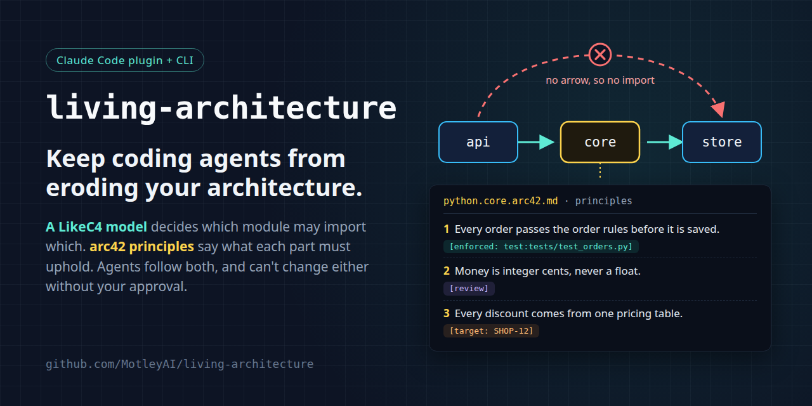

# living-architecture

A Claude Code plugin + CLI for agents writing Python and TypeScript code

[](https://github.com/MotleyAI/living-architecture/actions/workflows/ci.yml)
[](https://pypi.org/project/living-architecture/)
[](https://www.npmjs.com/package/living-architecture)
[](https://pypi.org/project/living-architecture/)
[](https://github.com/MotleyAI/living-architecture/blob/main/LICENSE)



* **Normative principles attached to a
[LikeC4](https://likec4.dev) architecture model, which also serves as an import whitelist.** 

* **Enforced by a complete
PR workflow that generates [OpenSpec](https://github.com/Fission-AI/OpenSpec) changes, whose archives double as
ADRs.**

## Introduction

Every PR an agent writes can be reasonable on its own while the codebase still drifts, one random decision at a time.
Putting every rule for every component into CLAUDE.md bloats context to the point where they are all ignored anyway.
Random agent decisions from one PR are treated as design patterns by the next session, with the codebase gradually growing 
bizarre structure no one wanted. And six months later, nobody can say why the code is the way it is. 

The plugin, `la`, prevents architectural drifts via these interlocking components:

- **Principles attached to the parts of your code.** A [LikeC4](https://likec4.dev) model maps your packages to
  elements, and each element carries its own [arc42](https://arc42.org) file of normative principles, each tagged
  with how it is enforced. Every stage of a change starts by reading the principles of what it touches, and
  changing a principle needs your approval.
- **A complete PR workflow.** `/la:pr` interviews you into a Codex-reviewed plan, writes the failing tests,
  implements until they pass, then loops deterministic checks (lint, typing, share of comment lines in the code, and more),
  CI, Codex, CodeRabbit and Sonar until every gate is clean.
  Each stage ends at a hard stop and resumes from the branch name alone.
- **A decision record for every PR.** The plan is a validated OpenSpec change. Before the PR merges, it is archived in
  the same PR as the code, with the decisions and the alternatives 
  rejected: an ADR you never had to write.
- **An architecture that is enforced, not just drawn.** The model's arrows are also a whitelist for which modules can import which,
  and `la-arch-check` fails when the real imports disagree.

For the details, see [How it works](https://github.com/MotleyAI/living-architecture/blob/main/docs/how-it-works.md) and
[Living architecture in questions and answers](https://github.com/MotleyAI/living-architecture/blob/main/docs/living-architecture-in-questions-and-answers.md).

For an example of a project using this, look at [SLayer](https://github.com/MotleyAI/slayer), here is a [juicy example of a real-world principles document](https://github.com/MotleyAI/slayer/blob/main/architecture/sql.arc42.md).
## Install

```bash
# the plugin (installing la also installs trmv, the type-rename-move plugin it depends on)
/plugin marketplace add MotleyAI/living-architecture
/plugin install la@living-architecture

# the commands (la-*, trmv-*), pinned to the same version as the plugin, from your repo's ecosystem
uv tool install living-architecture==0.14.0 --with-executables-from type-rename-move   # Python repos (Python >= 3.11)
npm install -g living-architecture@0.14.0 type-rename-move@0.14.0                      # TypeScript/JavaScript repos (Node >= 22)
```

The repo ships two packages that release together: `type-rename-move` (the `trmv-*` commands and the `trmv`
plugin: verified renames and moves and the type-check gate) and `living-architecture` (the `la-*` commands and the
`la` plugin), which depends on it. Each comes as a PyPI package and an npm package of the same name, with identical
behaviour. Each serves its own ecosystem natively, needs nothing from the other in a single-language repo, and calls
the other for the other language's files in a mixed repo
([details](https://github.com/MotleyAI/living-architecture/blob/main/docs/commands.md#two-twins)). Skills check
that the installed commands match the plugin before they run; a plugin update within the same minor version needs no
reinstall.

### Upgrading

1. Update the plugin: `claude plugin marketplace update living-architecture`, then
   `claude plugin update la@living-architecture` (third-party marketplaces don't auto-update by default).
2. Rerun the install command above at the new version.
3. When `la-doctor` asks, run `la-arch-migrate` once per repo and commit the result.

A skill's preflight catches a gap between these steps and prints the fix.

**From 0.13:** renames and moves are now the `trmv` package and plugin: `trmv-refactor`, `trmv-compliance`,
`trmv-mock-lint`, `trmv-typecheck` and the `trmv:` skills. `la-typecheck` stays as a deprecated alias until 0.15.0.

### Just renames and moves

To get verified renames and moves without the architecture workflow, install only trmv:

```bash
/plugin install trmv@living-architecture
uv tool install type-rename-move==0.14.0      # Python repos
npm install -g type-rename-move@0.14.0        # TypeScript/JavaScript repos
```

Then run `/trmv:init` in the repo: it writes `trmv.yaml` with the test and type-check commands.

## Quick start

In the repo you want to onboard, run:

```
/la:init
```

It detects your tracker, test, lint and type-check commands, Codex, Sonar and any existing OpenSpec or
architecture setup, then proposes a `living-architecture.yaml` and asks only about what it cannot detect. It then
offers to set up OpenSpec, record the type-check baseline and build the architecture with `/la:arch-init`, which
starts from a model measured from your code and then interviews you about the target structure and the
principles.

### Just enforce the architecture

You don't need the PR workflow or OpenSpec to hold an agent to the model and its principles: decline OpenSpec in
`/la:init`, which will ask you to build the model with `/la:arch-init`; then point the agent at the

```
/la:living-architecture
```

skill, for example in your `CLAUDE.md` or `AGENTS.md`.

The skill has the agent read the principles of every part of the code it touches before changing it, and run three
checks before it finishes: `la-arch-check` holds the imports to the model's arrows and checks the principles' tags,
`likec4 validate` checks the model itself, and `trmv-typecheck` runs basedpyright (or `tsc`) against a baseline that
only shrinks.

To run the same checks in CI, see
[Running the checks in CI](https://github.com/MotleyAI/living-architecture/blob/main/docs/ci.md).

### Use the PR workflow that enforces architecture and creates OpenSpec

Start each change on a branch named after its issue with:

```
/la:pr
```

This will guide you through each of the stages of the PR workflow; at the end of each stage it will tell you to 
call `/clear` and start the next stage by calling `/la:pr` again. 

## Skills

| Skill | Purpose |
|---|---|
| `la:init` | Onboard a repo: detect its tools, write `living-architecture.yaml`, then set up OpenSpec and build the first architecture model and its principles with `la:arch-init` |
| `la:pr` | Run a change through plan → failing tests → implementation → review |
| `trmv:init` | Onboard a repo to trmv alone: detect its test and type-check commands, write `trmv.yaml`, record the type-check baseline |
| `trmv:rename-move` | Rename or move Python or TypeScript code, proven complete by the type checker |

These skills call helper skills that you can also run on their own; see
[Skills](https://github.com/MotleyAI/living-architecture/blob/main/docs/skills.md).

## How it relates to other tools

- **Import-boundary checkers** ([import-linter](https://github.com/seddonym/import-linter) for Python;
  [dependency-cruiser](https://github.com/sverweij/dependency-cruiser),
  [eslint-plugin-boundaries](https://github.com/javierbrea/eslint-plugin-boundaries) and
  [Nx module boundaries](https://nx.dev/docs/features/enforce-module-boundaries) for TypeScript) check imports
  against rules in a config file. In `la` the rules are the same diagram the agent reads, they must match the code
  in both directions, one model covers Python and TypeScript, and the import law is only the backbone that the
  principles and the specs hang on. If all you need is layer rules for one language, those tools are lighter.
- **OpenSpec on its own** gives you the spec format and the archive. `la` drives it: the plan stage writes and
  validates the change, the later stages hold the code to it, and the review stage archives it with the PR.
- **ADRs written by hand** tend to stop being written. Here the decision record is a by-product of planning the
  change, so every PR has one.

## Prerequisites

Always: `git`, `bash`, `gh` (authenticated) and `jq`.

Per repo language (`trmv-doctor` and `la-doctor` check them):

| Language | Needs |
|---|---|
| Python | Python >= 3.11; the PyPI packages; basedpyright in the project env for the type-check gate |
| TypeScript | `node` (>= 22) and `npx`; the npm packages; `tsc` in `node_modules` for the type-check gate |

The rest is optional. `/la:init` detects what you have, asks before turning on anything it can't find, and
records the choice in `living-architecture.yaml`:

| Gate | Needs |
|---|---|
| `tracker: linear` | the Linear MCP server |
| `tracker: github` | nothing beyond `gh` |
| `openspec: true` | `npx` (the OpenSpec CLI) |
| `architecture: true` | `npx` (the LikeC4 CLI) |
| `reviewers.codex: true` | the Codex MCP server (`mcp__codex__codex`) |
| Sonar on your PRs | the SonarQube MCP server |

## Background

The ideas behind the plugin, and how it came out of the [SLayer](https://github.com/MotleyAI/slayer) codebase,
which uses it:

- [Why I no longer read code (much)](https://dev.to/egor_kraev_0e262330fbb44b/why-i-no-longer-read-code-much-1d59):
  the four-stage PR flow
- [How I enforce architecture on coding agents](https://dev.to/egor_kraev_0e262330fbb44b/how-i-enforce-architecture-on-coding-agents-141a):
  modularity and principle-based development
- [Living architecture, enforced](https://dev.to/egor_kraev_0e262330fbb44b/living-architecture-enforced-2ffh):
  the LikeC4 import law and the arc42 principles

## Documentation

- [How it works](https://github.com/MotleyAI/living-architecture/blob/main/docs/how-it-works.md): the principles, the PR workflow, its ADRs
  and the import check, and how to use the check on its own
- [Living architecture in questions and answers](https://github.com/MotleyAI/living-architecture/blob/main/docs/living-architecture-in-questions-and-answers.md):
  the problems it solves, one by one
- [Skills](https://github.com/MotleyAI/living-architecture/blob/main/docs/skills.md): main and helper skills
- [Configuration](https://github.com/MotleyAI/living-architecture/blob/main/docs/configuration.md): `living-architecture.yaml`, `trmv.yaml` and the language sections of `architecture/index.yaml`
- [Commands](https://github.com/MotleyAI/living-architecture/blob/main/docs/commands.md): the `la-*` and `trmv-*` commands
- [Running the checks in CI](https://github.com/MotleyAI/living-architecture/blob/main/docs/ci.md)
- [Renames and moves](https://github.com/MotleyAI/living-architecture/blob/main/docs/rename-and-move.md)
- [Inside trmv-refactor](https://github.com/MotleyAI/living-architecture/blob/main/docs/refactoring-internals.md): the libraries and processes behind it
- [Development](https://github.com/MotleyAI/living-architecture/blob/main/docs/development.md): working from a checkout, layout, releasing
- [Contributing](https://github.com/MotleyAI/living-architecture/blob/main/CONTRIBUTING.md) and
  [release notes](https://github.com/MotleyAI/living-architecture/releases)
