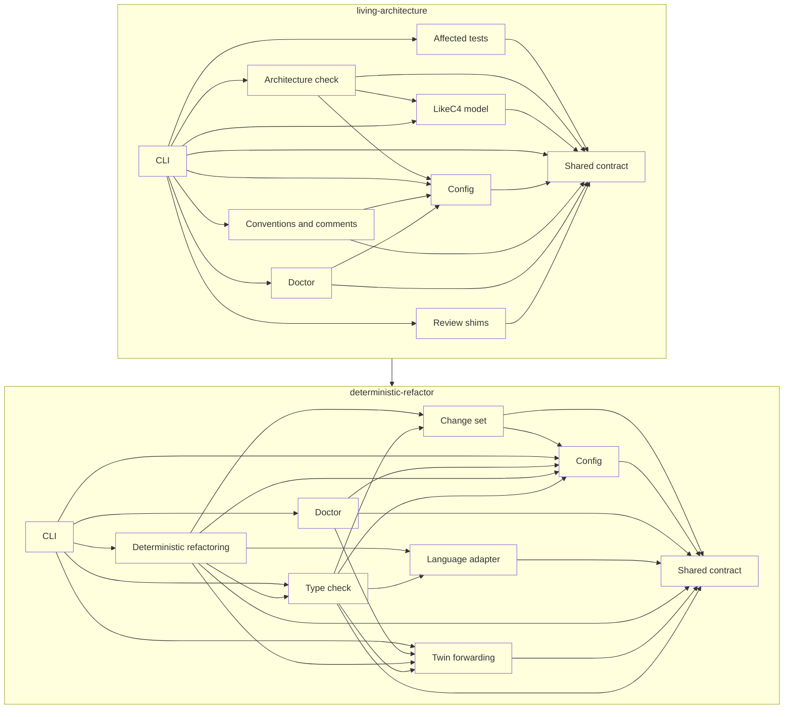
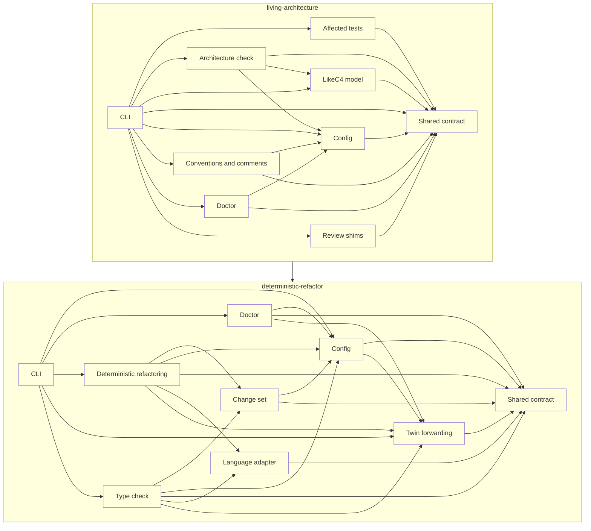

# System

## Purpose and context

Two packages, each with a Claude Code plugin: `deterministic-refactor` (`dr-*` commands, plugin `dr`): verified
renames and moves and the type-check gate; and `living-architecture` (`la-*` commands, plugin `la`): the
architecture cross-check, the conventions gate, the review helpers and the PR flow. la depends on dr. Each package
has two native implementations (twins) that obey its contract in `shared/<package>/`: the PyPI packages in
`python/` serve Python repos, and the npm packages in `node/` serve TS/JS repos. The skills in `plugin/<package>/`
drive the commands.

## Building blocks

<!-- likec4:system -->

<!-- /likec4:system -->

<!-- likec4:npm -->

<!-- /likec4:npm -->

## Principles

1. Twins: every behaviour observable through a command is identical in both implementations for the
   languages they share, on every input in the forms the tools and docs write; the conformance corpus
   decides. [enforced: test:python/dr/tests/test_conformance.py]
   [enforced: test:python/la/tests/test_conformance.py] [enforced: test:node/scripts/conformance.mjs]
2. Parameters, defaults, user-facing texts and command surfaces come only from the shared contracts. [review]
3. Language-specific code lives only in `dr.lang` and `dr.refactor`. [review]
4. Tools never import or execute target-repo code, except a configured command (`commands.*`). [review]
5. `dr` never depends on `la`. [enforced: arch_check:model-truth]

## Rationale

Each ecosystem keeps native tooling: Python repos need no Node runtime for analysis and TS/JS repos need no
Python. Only the language-neutral core is implemented twice, so the shared contract and the conformance
corpus make drift a test failure instead of a review finding. The node split is the same in both twins, and
confining language-specific code to `lang` and `refactor` keeps everything else a straight port.

Verified refactoring is useful without the architecture workflow, so it is its own package that la uses as a library;
the dependency runs one way so dr installs and runs alone.
