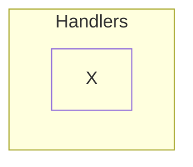
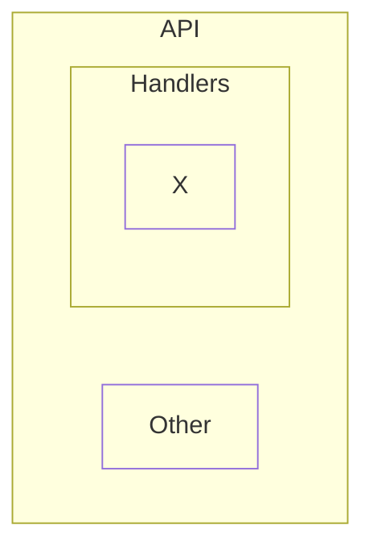
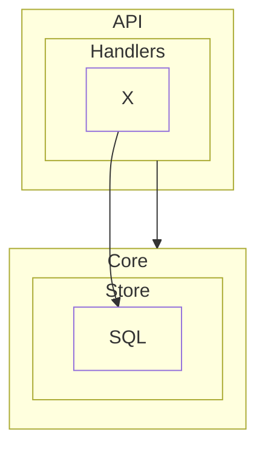
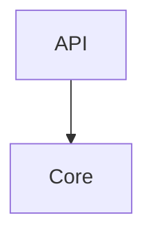
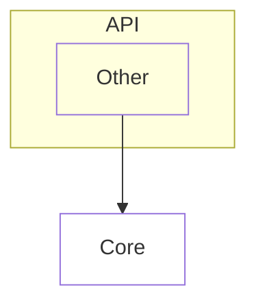
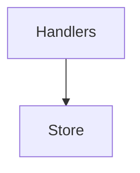

# System

<!-- likec4:nested -->

<!-- /likec4:nested -->

<!-- likec4:overlap -->

<!-- /likec4:overlap -->

<!-- likec4:anchored -->

<!-- /likec4:anchored -->

<!-- likec4:inbound -->

<!-- /likec4:inbound -->

<!-- likec4:descend -->

<!-- /likec4:descend -->

<!-- likec4:flat -->

<!-- /likec4:flat -->
