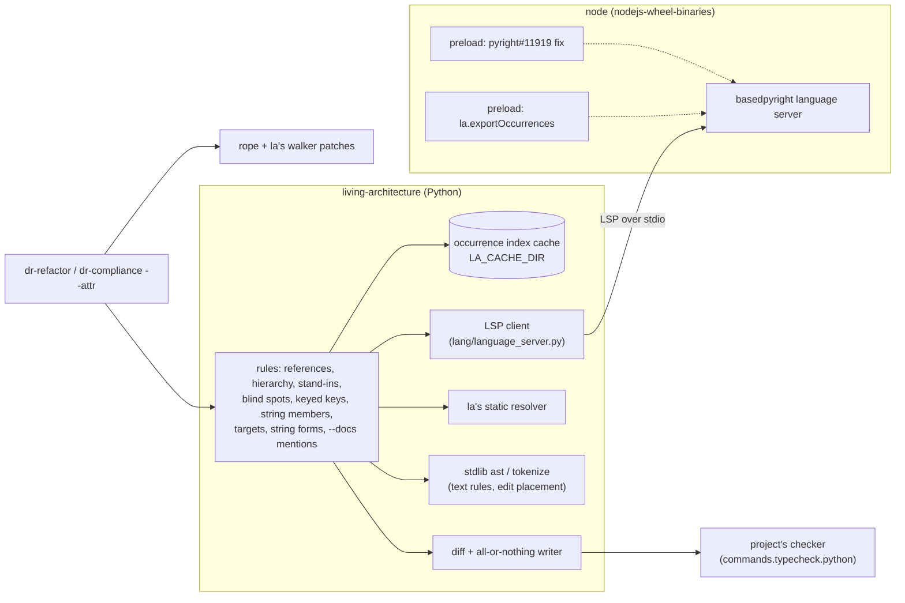

# Inside dr-refactor

Which libraries and processes `dr-refactor` (and `dr-compliance --attr`) use, and what each one is for. For what
the commands do, see [Deterministic refactoring](deterministic-refactoring.md).

## Python twin

| Component | Used for | Needed because |
|---|---|---|
| basedpyright (bundled, pinned) | The occurrence index: every occurrence of each old name with its declarations, class, MRO and receiver type. Also the `Literal` and string-member probes. | It is the type checker the gate trusts. A rename resolved by the checker that later verifies it can't disagree with it. |
| Node (`nodejs-wheel-binaries`) | Runs basedpyright, which is a Node program. | basedpyright's own dependency. The project needs no Node. |
| LSP | The protocol la uses to talk to one long-lived basedpyright process. la's client is about 350 lines. | It's the only stable host for basedpyright's analysis. The server finds the project's configuration and interpreter itself, takes in-memory file texts (the snapshot and the probes), and keeps one warm program for the whole run. |
| la's preloads | Patch basedpyright's bundle as Node loads it: the pyright#11919 fix, and the export command that returns the whole index in one request. | basedpyright has no batch export (requested upstream as basedpyright#1909). Both are pinned to verified versions; any other version refuses. |
| rope (+ la's walker patches) | Computes `move-symbol` and `move-module`. | Moves are built on it. |
| la's static resolver | Resolves names, imports and module attribute chains by Python's scoping over the project's source folders: entry locations, the names basedpyright leaves unresolved, retarget's lookups and module renames. | It reads files only, so it resolves what the checker's configuration misses without running project code. |
| stdlib `ast` / `tokenize` | Edit placement, `--docs` mentions and their owning classes, string forms, kept literals, compound names, dict-key and keyword shapes. | These rules read text and syntax only. |
| Occurrence index cache | Reuses the index when nothing that can change it has changed (sources, config, interpreter, packages, request). | It makes the dry-run → fix flags → re-run loop cost no checker time. |
| The project's checker | Keeps the type-check baseline aligned after the edits. | The baseline belongs to the checker the project configures, not to la's bundled one. |

A run locates each map entry from the syntax tree and la's static resolver first. Then it reads the index from the cache, or exports it in one
request, and runs every rule over it. Finally it prints one diff and, with `--apply`, writes every file or none.
Module renames and moves never start the language server.

## TypeScript twin

The npm twin uses only the bundled `typescript` package. Its in-process language service locates symbols, finds
references and rename locations, types receivers, and keeps the baseline aligned. There's no second process, no
protocol and no second resolver.
