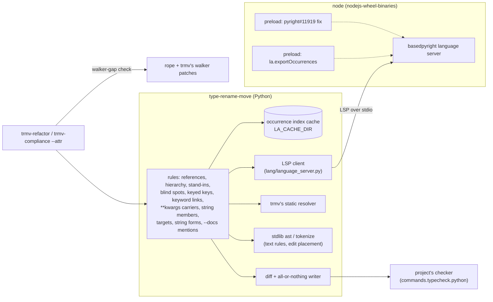

# Inside trmv-refactor

Which libraries and processes `trmv-refactor` (and `trmv-compliance --attr`) use, and what each one is for. For what
the commands do, see [Renames and moves](rename-and-move.md).

## Python twin

| Component | Used for | Needed because |
|---|---|---|
| basedpyright (bundled, pinned) | The occurrence index: every occurrence of each old name with its declarations, class, MRO and receiver type. Also the `Literal`, string-member and keyword-signature probes. | It is the type checker the gate trusts. A rename resolved by the checker that later verifies it can't disagree with it. |
| Node (`nodejs-wheel-binaries`) | Runs basedpyright, which is a Node program. | basedpyright's own dependency. The project needs no Node. |
| LSP | The protocol trmv uses to talk to one long-lived basedpyright process. trmv's client is about 350 lines. | It's the only stable host for basedpyright's analysis. The server finds the project's configuration and interpreter itself, takes in-memory file texts (the snapshot and the probes), and keeps one warm program for the whole run. |
| trmv's preloads | Patch basedpyright's bundle as Node loads it: the pyright#11919 fix, and the export command that returns the whole index in one request. | basedpyright has no batch export (requested upstream as basedpyright#1909). Both are pinned to verified versions; any other version refuses. |
| rope (+ trmv's walker patches) | The walker-gap check: a move's `checks` phase and `trmv-compliance --select rope-walk`. | Only that check is left; no refactor is computed with rope. |
| trmv's static resolver | Resolves names, imports and module attribute chains by Python's scoping over the project's source folders: entry locations, the names basedpyright leaves unresolved, retarget's lookups, module renames and moves. | It reads files only, so it resolves what the checker's configuration misses without running project code. |
| stdlib `ast` / `tokenize` | Edit placement, a moved symbol's region and imports, `--docs` mentions and their owning classes, string forms, kept literals, compound names, dict-key and keyword shapes. | These rules read text and syntax only. |
| Occurrence index cache | Reuses the index when nothing that can change it has changed (sources, config, interpreter, packages, request). | It makes the dry-run → fix flags → re-run loop cost no checker time. |
| The project's checker | Keeps the type-check baseline aligned after the edits. | The baseline belongs to the checker the project configures, not to trmv's bundled one. |

A run locates each map entry from the syntax tree and trmv's static resolver first. Then it reads the index from the cache, or exports it in one
request, and runs every rule over it. Finally it prints one diff and, with `--apply`, writes every file or none.
Module renames and moves never start the language server.

A call keyword `old=` the checker resolves to no declaration of that name is linked in one of two ways. A parameter
rename asks the checker for the callee's signature again, with the renamed parameters renamed in memory: the keyword
follows when every callable alternative binds the old name before and the new name after. A `**kwargs` carrier (a
`def` whose `**kw` only reaches calls it is unpacked into, key lookups and truth tests) passes the keyword on to what
it builds: a keyed class, a function, a constructor or another carrier. A keyword proved to land on another
declaration, or on none, is left alone. Any other keyword neither rule links (a callee whose signature does not bind
the name, a carrier whose flow is mixed or unprovable), and one on a callee typed `Unknown`, `Any` or `Never`, is an
`unlinked-keyword` blind spot of a parameter or field rename.

Before a Python refactor prints its changes or writes anything, it checks each file it would write. A file that
parsed must still parse, and its new bytes must decode, in the encoding they declare, to its new text. `move-symbol`
and `move-module` then build the project as the move would leave it in a temporary directory, resolve it with trmv's
static resolver, and compare it with the project as read, file by file. The move is refused with
`resolution-changed` when a name or attribute chain would resolve to another declaration or module, when a read that
runs at import time would lose its top-level binding, when a top-level name would get another value, or when a
literal `__all__` would differ from what the move intends.

## TypeScript twin

The npm twin uses only the bundled `typescript` package. Its in-process language service locates symbols, finds
references and rename locations, types receivers, and keeps the baseline aligned. There's no second process, no
protocol and no second resolver.
