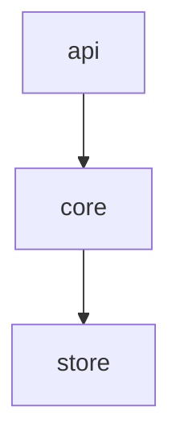

# System

## Purpose and context

A toy shop: `api` takes orders, `core` holds the order rules, `store` persists them.

## Building blocks

<!-- likec4:python -->

<!-- /likec4:python -->

## Principles

1. Every order goes through `core`, so the order rules hold for every caller. [review]

## Rationale

Keeping `api` away from `store` means a storage change never reaches the HTTP layer.
